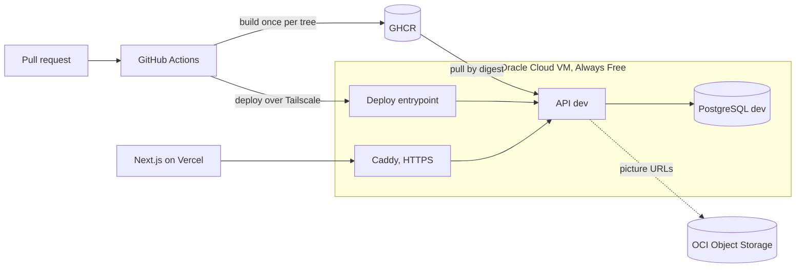

# Backend Showcase

English | [Українська](README.uk.md)

[](https://github.com/VladSkopenko/backend-showcase/actions/workflows/ci.yml)

A REST API for a restaurant chain, built to show delivery engineering end to end: quality gates in
CI, images built once and promoted by digest, infrastructure as code and a real server, all on free
tiers.

## Try it

| What | Link |
|---|---|
| API on dev | https://backend-showcase-dev.duckdns.org/health |
| API docs (Swagger) | https://backend-showcase-dev.duckdns.org/docs |
| Frontend | https://family-rest.vercel.app, source in [LudSkop/family-rest](https://github.com/LudSkop/family-rest) |

Staging and production already have their branches (`rc`, `prod`) and domains. They go live with
the first release.

## What is built

| Area | What works today |
|---|---|
| CI | Every pull request runs ruff, mypy, architecture contracts (import-linter), a migration round-trip with `alembic check`, and pytest against a real PostgreSQL |
| Images | A multi-stage Dockerfile with a non-root user and a healthcheck. Each git tree is built once on an arm64 runner, scanned with Trivy and pushed to GHCR ([ADR 4](docs/adr/0004-image-identity-and-promotion.md)) |
| Deploy | A merge to `main` deploys dev with no manual steps. CI reaches the server only through Tailscale, and a forced-command entrypoint deploys only commits from the environment's branch ([ADR 2](docs/adr/0002-ci-access-through-tailscale.md), [ADR 3](docs/adr/0003-deploy-entrypoint-verifies-commit.md)) |
| Infrastructure | Terraform for the Oracle Cloud VM, network, data volume, media bucket and its IAM; cloud-init for the base OS; the server is replaced, not patched ([ADR 8](docs/adr/0008-terraform-and-immutable-server.md)) |
| Platform | Caddy with automatic HTTPS in front of the app stacks; one VM, a platform stack and an app stack per environment ([ADR 7](docs/adr/0007-single-vm-platform-and-app-stacks.md)) |
| API | Registration with email verification, JWT sessions with refresh rotation, password reset, Google sign-in, a menu with pictures in Object Storage, restaurant locations with their tables, table booking with a slot grid and double-booking protection, editing a booking (time, guests, stay length) |

## Architecture



## How a commit reaches dev

1. A pull request into `main` runs the CI checks.
2. After the merge, the delivery workflow builds the image for the git tree, unless that tree is
   already in GHCR, and scans it with Trivy.
3. The deploy job joins the tailnet and calls the server's entrypoint with the commit.
4. The entrypoint checks that the commit is on `main`, pulls the image, runs `alembic upgrade head`,
   and starts the API, waiting for its healthcheck.

Staging and production will receive the same image by digest, through pull requests from `main` to
`rc` and from `rc` to `prod` ([ADR 4](docs/adr/0004-image-identity-and-promotion.md)). Their
deploy jobs come with the first release.

## Backend design

- Python 3.14, FastAPI, Pydantic v2, SQLAlchemy 2 async, Alembic, uv.
- Feature-sliced layout ([ADR 11](docs/adr/0011-feature-sliced-backend-layout.md)). Core features
  (users, auth, health, menu, locations, bookings) are shared. Regular features never import each other.
  Inside a feature, calls go `endpoints → services → repositories → models`. import-linter enforces
  these rules in CI.
- Reference data such as the menu and the locations ships as migrations, so every environment gets
  it without access to the server.
- Swagger groups routes by user flow (Registration, Session, Menu, Locations, Booking) rather than by module.

## Decisions

Each non-obvious choice has a short record in [docs/adr](docs/adr):

| ADR | Decision |
|---|---|
| [2](docs/adr/0002-ci-access-through-tailscale.md) | CI reaches the server only through Tailscale |
| [3](docs/adr/0003-deploy-entrypoint-verifies-commit.md) | The deploy entrypoint takes a commit and verifies it |
| [4](docs/adr/0004-image-identity-and-promotion.md) | Images are identified by tree hash and promoted by digest |
| [5](docs/adr/0005-migration-rollback-with-alembic.md) | Failed deploys roll back migrations with Alembic |
| [6](docs/adr/0006-data-stack-per-environment.md) | Each environment runs its own PostgreSQL and Redis |
| [7](docs/adr/0007-single-vm-platform-and-app-stacks.md) | One VM runs a platform stack and an app stack per environment |
| [8](docs/adr/0008-terraform-and-immutable-server.md) | Terraform from the start, and the server is immutable |
| [9](docs/adr/0009-alerting-from-outside-the-vm.md) | Alerting must work when the VM does not |
| [10](docs/adr/0010-frontend-in-a-separate-repository.md) | The frontend lives in a separate repository |
| [11](docs/adr/0011-feature-sliced-backend-layout.md) | Feature-sliced backend layout |
| [12](docs/adr/0012-unified-error-response.md) | One error response format for the whole API |
| [13](docs/adr/0013-table-booking-slots-and-double-booking.md) | Fixed booking slots; row locks and an exclusion constraint prevent double booking |
| [14](docs/adr/0014-booking-simulator-on-dev.md) | n8n simulates visitors on dev only, with bots from an environment-gated migration |

## Run it locally

From `backend/`:

```bash
uv sync
docker compose up -d                       # PostgreSQL on 127.0.0.1:5433
uv run alembic upgrade head
uv run uvicorn app.main:app --port 8000    # http://127.0.0.1:8000/docs
uv run pytest
```

## Running for $0

| Need | Free option |
|---|---|
| Server | Oracle Cloud Always Free, one Ampere A1 VM (Arm) |
| CI/CD and registry | GitHub Actions and GHCR in a public repository |
| Domains and HTTPS | DuckDNS subdomains, Caddy with Let's Encrypt |
| State, backups, pictures | OCI Object Storage |
| Private access | Tailscale |

## Built with AI agents

The repository is built with Claude Code and the BMAD method, and the setup is part of the showcase.
`CLAUDE.md` and `.claude/rules/` define the workflow: spec first, tests first, independent reviews,
then a live check. `.claude/settings.json` adds guardrails: git changes and migrations ask first,
and secrets are never read. Every feature starts from a spec in `_bmad_output/`. Infrastructure is
written by hand.

## What is next

- Observability: metrics, dashboards, logs and alerts to Telegram
- Staging and production live, with migration rollback on a failed deploy
- Table booking, cart and orders as a state machine with a live tracker
- Load tests with k6 and published numbers

The full plan is in [docs/roadmap.md](docs/roadmap.md).
