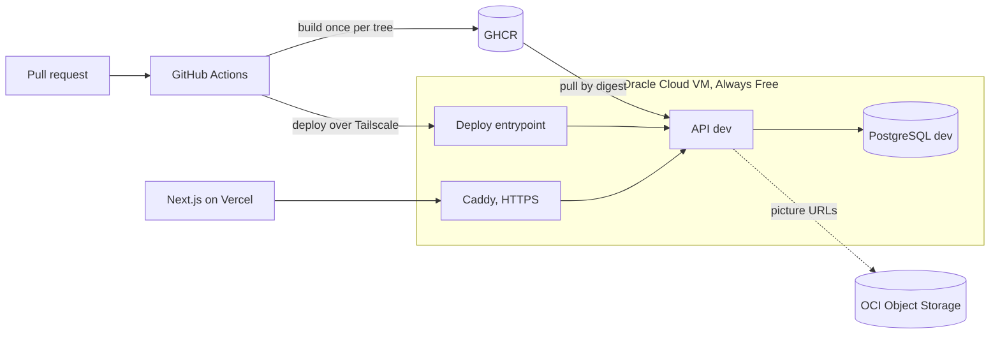

# Backend Showcase

English | [Українська](README.uk.md)

[](https://github.com/VladSkopenko/backend-showcase/actions/workflows/ci.yml)
[](https://sonarcloud.io/summary/new_code?id=VladSkopenko_backend-showcase)
[](https://sonarcloud.io/summary/new_code?id=VladSkopenko_backend-showcase)
[](https://sonarcloud.io/summary/new_code?id=VladSkopenko_backend-showcase)
[](https://sonarcloud.io/summary/new_code?id=VladSkopenko_backend-showcase)

A REST API for a restaurant chain: table booking that holds under concurrent requests, sessions with
refresh-token rotation, group pre-orders and an AI assistant that acts through confirmed cards. It is
shipped the way production services are: quality gates in CI, images built once and promoted by
digest, infrastructure as code and a real server, all on free tiers. The restaurant is the domain;
the point is the whole path from a pull request to a monitored server.

## Start here

| What to look at | Where |
|---|---|
| Double booking under concurrent requests: the user row, then the table row are locked, and an exclusion constraint backs them up ([ADR 13](docs/adr/0013-table-booking-slots-and-double-booking.md)) | `BookingService.create` and `edit` in [booking_service.py](backend/src/app/features/core/bookings/services/booking_service.py) |
| A test that races two real transactions against those locks | [test_booking_concurrency.py](backend/tests/test_booking_concurrency.py) |
| Refresh-token rotation: two refreshes of one token run one after the other, and a reused token revokes every session of the user | `SessionService.refresh` in [session_service.py](backend/src/app/features/core/auth/services/session_service.py) |
| Database constraint violations mapped to domain errors by constraint name | [constraint_errors.py](backend/src/app/common/constraint_errors.py) |
| Layer and feature rules enforced in CI | `[tool.importlinter]` in [pyproject.toml](backend/pyproject.toml), [ADR 11](docs/adr/0011-feature-sliced-backend-layout.md) |

## Try it

| What | Link |
|---|---|
| API on dev | https://backend-showcase-dev.duckdns.org/health |
| API docs (Swagger) | https://backend-showcase-dev.duckdns.org/docs |
| Frontend | https://family-rest.vercel.app, source in [LudSkop/family-rest](https://github.com/LudSkop/family-rest) |
| Dashboards (Grafana, no account needed) | https://backend-showcase-grafana.duckdns.org |
| Code quality (SonarCloud) | https://sonarcloud.io/summary/overall?id=VladSkopenko_backend-showcase |

The project runs one environment, dev, and ends there
([ADR 24](docs/adr/0024-the-project-ends-on-dev.md)).

## What is built

| Area | What works today |
|---|---|
| CI | Every pull request runs ruff, mypy, architecture contracts (import-linter), a migration round-trip with `alembic check`, and pytest against a real PostgreSQL |
| Images | A multi-stage Dockerfile with a non-root user and a healthcheck. Each git tree is built once on an arm64 runner, scanned with Trivy and pushed to GHCR ([ADR 4](docs/adr/0004-image-identity-and-promotion.md)) |
| Deploy | A merge to `main` deploys dev with no manual steps. CI reaches the server only through Tailscale, and a forced-command entrypoint deploys only commits from the environment's branch ([ADR 2](docs/adr/0002-ci-access-through-tailscale.md), [ADR 3](docs/adr/0003-deploy-entrypoint-verifies-commit.md)) |
| Infrastructure | Terraform for the Oracle Cloud VM, network, data volume, media bucket and its IAM; cloud-init for the base OS; the server is replaced, not patched ([ADR 8](docs/adr/0008-terraform-and-immutable-server.md)) |
| Platform | Caddy with automatic HTTPS in front of the app stacks; one VM, a platform stack and an app stack per environment ([ADR 7](docs/adr/0007-single-vm-platform-and-app-stacks.md)). Prometheus in the platform stack scrapes the dev API's request metrics; its UI is reachable only on the tailnet, at `https://backend-showcase-platform.tail88eb36.ts.net:9090` ([ADR 22](docs/adr/0022-prometheus-scrapes-dev.md)) |
| API | Registration with email verification, JWT sessions with refresh rotation, password reset, Google sign-in, a menu with pictures in Object Storage, restaurant locations with their tables, table booking with a slot grid and double-booking protection, editing a booking (time, guests, stay length), invites by link for friends with or without an account, a pre-order cart for every participant, and the whole group's pre-order for the booking owner. An AI assistant chat streams answers about the menu, the locations, free tables and the guest's own bookings and pre-order in the guest's language and books, changes or cancels a booking, changes the pre-order cart and sends the guest's pre-order through cards the guest confirms, under one daily budget for the system |
| Simulation | n8n in the platform stack plays the restaurant on dev: [booking simulator](n8n/workflows/booking-simulator.json) (40 guest bots book, send large-party requests, pre-order and cancel every 2 minutes) and [waiter bot](n8n/workflows/waiter-bot.json) (a staff bot approves or rejects the requests). The editor is reachable only on the tailnet, at `https://backend-showcase-platform.tail88eb36.ts.net:5678` ([ADR 14](docs/adr/0014-booking-simulator-on-dev.md), [n8n/README.md](n8n/README.md)) |
| Dashboards | A public Grafana opens without an account on five dashboards over the live dev data: bookings, dishes, checks, visitors and staff decisions, plus an API dashboard with the dev API's live request rate, 5xx share and latency from Prometheus ([ADR 22](docs/adr/0022-prometheus-scrapes-dev.md)). The dashboards are JSON files in [deploy/platform/grafana/dashboards](deploy/platform/grafana/dashboards), provisioned on deploy; Grafana reads dev through a database role that sees no emails, hashes or tokens, and a test runs every SQL panel query as that role ([ADR 19](docs/adr/0019-public-grafana-reads-dev.md)) |

### Simulation on dev

| Waiter bot | Booking simulator | Runs |
|---|---|---|
|  |  |  |

## Architecture



## How a commit reaches dev

1. A pull request into `main` runs the CI checks.
2. After the merge, the delivery workflow builds the image for the git tree, unless that tree is
   already in GHCR, and scans it with Trivy.
3. The deploy job joins the tailnet and calls the server's entrypoint with the commit.
4. The entrypoint checks that the commit is on `main`, pulls the image, runs `alembic upgrade head`,
   and starts the API, waiting for its healthcheck.

## Backend design

- Python 3.14, FastAPI, Pydantic v2, SQLAlchemy 2 async, Alembic, uv.
- Feature-sliced layout ([ADR 11](docs/adr/0011-feature-sliced-backend-layout.md)). Core features
  (users, auth, health, menu, locations, bookings) are shared. Regular features never import each other.
  Inside a feature, calls go `endpoints → services → repositories → models`. import-linter enforces
  these rules in CI.
- Reference data such as the menu and the locations ships as migrations, so every environment gets
  it without access to the server.
- Swagger groups routes by user flow (Registration, Session, Menu, Locations, Booking, Invites, Pre-order) rather than by module.
- Tests run against a real PostgreSQL, each rolled back through a savepoint, because the rules that
  matter live in row locks and constraints that a mocked session cannot check.
- Login locks an account after repeated wrong passwords. There is no per-IP limit on purpose: the
  frontend sends login through its Next.js server on Vercel, so the API sees Vercel's addresses,
  not the guests'.

## Decisions

Each non-obvious choice has a short record in [docs/adr](docs/adr):

| ADR | Decision |
|---|---|
| [2](docs/adr/0002-ci-access-through-tailscale.md) | CI reaches the server only through Tailscale |
| [3](docs/adr/0003-deploy-entrypoint-verifies-commit.md) | The deploy entrypoint takes a commit and verifies it |
| [4](docs/adr/0004-image-identity-and-promotion.md) | Images are identified by tree hash and deployed by digest; amended by ADR 24 to dev only |
| [5](docs/adr/0005-migration-rollback-with-alembic.md) | Superseded by ADR 24. Failed deploys roll back migrations with Alembic |
| [6](docs/adr/0006-data-stack-per-environment.md) | Each environment runs its own PostgreSQL; amended by ADR 24 to dev only, without Redis |
| [7](docs/adr/0007-single-vm-platform-and-app-stacks.md) | One VM runs a platform stack and an app stack; amended by ADR 24 to one app stack, dev |
| [8](docs/adr/0008-terraform-and-immutable-server.md) | Terraform from the start, and the server is immutable |
| [9](docs/adr/0009-alerting-from-outside-the-vm.md) | Superseded by ADR 23. Alerting must work when the VM does not |
| [10](docs/adr/0010-frontend-in-a-separate-repository.md) | The frontend lives in a separate repository |
| [11](docs/adr/0011-feature-sliced-backend-layout.md) | Feature-sliced backend layout |
| [12](docs/adr/0012-unified-error-response.md) | One error response format for the whole API |
| [13](docs/adr/0013-table-booking-slots-and-double-booking.md) | Fixed booking slots; row locks and an exclusion constraint prevent double booking |
| [14](docs/adr/0014-booking-simulator-on-dev.md) | n8n simulates visitors on dev only, with bots from an environment-gated migration |
| [15](docs/adr/0015-platform-as-code.md) | Platform as code: a merge to `main` deploys the whole platform |
| [16](docs/adr/0016-booking-participants-and-guest-identity.md) | Booking participants in core, invites as a regular feature, guests known by a hashed-token cookie |
| [17](docs/adr/0017-preorder-parts-per-participant.md) | Pre-order drafts per participant submitted into one group, the owner's view of the whole group, live prices, the join window and the booking lock |
| [18](docs/adr/0018-in-app-notifications.md) | Superseded by ADR 21. In-app notifications written in the decision's transaction, emails after the commit, skipped domains |
| [19](docs/adr/0019-public-grafana-reads-dev.md) | Public Grafana reads dev through a role limited to listed columns; the role is the security boundary |
| [20](docs/adr/0020-assistant-composes-ai-tools.md) | A feature's AI tools live in `ai_tools/` beside its endpoints as a second adapter over its services; the assistant is their only composition root |
| [21](docs/adr/0021-decisions-by-email-only.md) | Staff decisions reach guests by email only; the in-app notification list is removed |
| [22](docs/adr/0022-prometheus-scrapes-dev.md) | Prometheus in the platform stack scrapes dev with `env` from its config, UI on the tailnet; Caddy is the metrics port's boundary |
| [23](docs/adr/0023-observability-ends-with-logs.md) | Observability ends with logs: no alerting, watchdog, traces or Redis exporter |
| [24](docs/adr/0024-the-project-ends-on-dev.md) | The project ends on dev: no staging or production, migration rollback, Redis, backups or load tests |

## Run it locally

From `backend/`:

```bash
uv sync
docker compose up -d                       # PostgreSQL on 127.0.0.1:5433
uv run alembic upgrade head
uv run uvicorn app.main:create_app --factory --port 8000    # http://127.0.0.1:8000/docs
uv run pytest
```

## Running for $0

| Need | Free option |
|---|---|
| Server | Oracle Cloud Always Free, one Ampere A1 VM (Arm) |
| CI/CD and registry | GitHub Actions and GHCR in a public repository |
| Domains and HTTPS | DuckDNS subdomains, Caddy with Let's Encrypt |
| Terraform state, pictures | OCI Object Storage |
| Private access | Tailscale |

## How it is built

I design the system and make the decisions; Claude Code writes most of the code under rules I set,
and I review every change before it merges.

- **The decisions are mine:** the feature-sliced layers and their import-linter contracts, the
  object-oriented style, one error format for the API, tests on a real database, the locking and
  token design. Product rules are signed in the specs as "Decisions (Vlad, date)" in
  [`_bmad_output/`](_bmad_output/implementation-artifacts).
- **The agent works inside guardrails I wrote:** [`CLAUDE.md`](CLAUDE.md) and
  [`.claude/rules/`](.claude/rules) (spec first, failing tests first, every config key checked
  against the official docs) and [`.claude/settings.json`](.claude/settings.json) (git changes and
  migrations ask first, secrets are never read).
- **I overrule it when it is wrong:** it proposed accepting real SonarCloud findings instead of fixing
  them ([6469d44](https://github.com/VladSkopenko/backend-showcase/commit/6469d443e3d70c825addd68847c85af33775926f)
  fixed them all), and it
  replaced the assistant's event names with magic strings to silence a rule
  ([#58](https://github.com/VladSkopenko/backend-showcase/pull/58) made them an enum instead).
- I learned the infrastructure on this project, building it together with the agent: CI/CD, Docker,
  Terraform, Tailscale, Prometheus and Grafana.

## What is left

- Metrics of the dev PostgreSQL, then logs in VictoriaLogs. After that the project is finished
  ([ADR 23](docs/adr/0023-observability-ends-with-logs.md),
  [ADR 24](docs/adr/0024-the-project-ends-on-dev.md)).

The plan, with what was built and what was dropped, is in [docs/roadmap.md](docs/roadmap.md).
