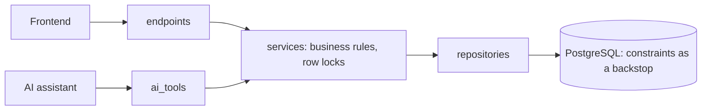
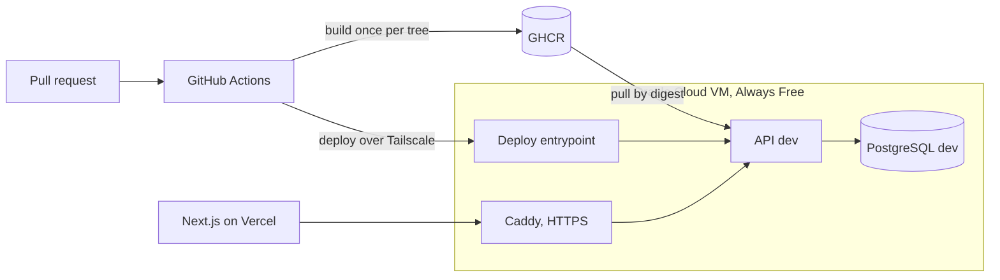

# Backend Showcase

English | [Українська](README.uk.md)

[](https://github.com/VladSkopenko/backend-showcase/actions/workflows/ci.yml)
[](https://sonarcloud.io/summary/new_code?id=VladSkopenko_backend-showcase)
[](https://sonarcloud.io/summary/new_code?id=VladSkopenko_backend-showcase)

Two things in one repository: the **backend** of a restaurant (guests book tables, invite friends,
pre-order dishes and talk to an AI assistant) and the **cloud and CI/CD** that run it live on a real
server, deployed from `main` with no manual steps, monitored, and free to run.

## Live

| What | Link |
|---|---|
| Frontend | https://family-rest.vercel.app ([source](https://github.com/LudSkop/family-rest)) |
| API docs (Swagger) | https://backend-showcase-dev.duckdns.org/docs |
| Dashboards, no account needed | https://backend-showcase-grafana.duckdns.org |
| Code quality | https://sonarcloud.io/summary/overall?id=VladSkopenko_backend-showcase |

Bots in n8n play the restaurant around the clock: guests book, pre-order and cancel, and a waiter bot
decides large-party requests, so the dashboards always move.

---

## Part 1. Backend

### What it does

- Sign up with email verification or Google; sessions with refresh-token rotation.
- Book a table on a slot grid, safe under concurrent requests; edit or cancel it.
- Invite friends by link, with or without an account.
- Pre-order per guest, with the whole group's order for the booking owner.
- Staff approve or reject large-party requests.
- An AI assistant answers about the menu and bookings and acts only through cards the guest confirms.

### How it is built



- Python 3.14, FastAPI, SQLAlchemy 2 async, Alembic.
- Feature-sliced layout: core features (users, auth, menu, locations, bookings) are shared, regular
  features never import each other, and calls go one way, endpoints to services to repositories.
  import-linter enforces it in CI ([ADR 11](docs/adr/0011-feature-sliced-backend-layout.md)).
- One error format for the whole API ([ADR 12](docs/adr/0012-unified-error-response.md)).
- Tests run on a real PostgreSQL, because the rules that matter live in row locks and constraints.

### Where to look in the code

| What | Where |
|---|---|
| Double booking under concurrent requests: row locks plus an exclusion constraint ([ADR 13](docs/adr/0013-table-booking-slots-and-double-booking.md)) | [booking_service.py](backend/src/app/features/core/bookings/services/booking_service.py) |
| A test that races two real transactions | [test_booking_concurrency.py](backend/tests/test_booking_concurrency.py) |
| Refresh-token rotation; a reused token revokes every session | [session_service.py](backend/src/app/features/core/auth/services/session_service.py) |
| Database errors mapped to domain errors by constraint name | [constraint_errors.py](backend/src/app/common/constraint_errors.py) |

---

## Part 2. Cloud and CI/CD

### How a commit reaches the server



### What runs it

| Part | How |
|---|---|
| CI | ruff, mypy, import-linter, migration round-trip and pytest on a real PostgreSQL for every pull request |
| Delivery | One image per git tree, scanned with Trivy, deployed by digest; CI reaches the server only through Tailscale ([ADR 2](docs/adr/0002-ci-access-through-tailscale.md), [ADR 4](docs/adr/0004-image-identity-and-promotion.md)) |
| Server | Oracle Cloud VM, network and storage in Terraform; replaced, not patched ([ADR 8](docs/adr/0008-terraform-and-immutable-server.md)) |
| Platform | Caddy, n8n, Prometheus and Grafana as code, deployed on every merge ([ADR 15](docs/adr/0015-platform-as-code.md)) |
| Monitoring | Prometheus collects the API, the server and the database; the public Grafana shows them ([ADR 22](docs/adr/0022-prometheus-scrapes-dev.md)) |
| Cost | $0: Oracle Always Free, GitHub Actions and GHCR, DuckDNS, Tailscale |

---

## How I work

I design the system and make the decisions; Claude Code writes most of the code inside rules I set,
and I review every change before it merges.

- The rules are in [`CLAUDE.md`](CLAUDE.md) and [`.claude/rules/`](.claude/rules): spec first, failing
  tests first, every config key checked against the official docs.
- [`_bmad_output/`](_bmad_output/implementation-artifacts) holds the feature specs in the order they
  were built: each one states the problem, the decisions I made (signed "Decision (Vlad, date)"), the
  tests that came first and the review log.
- I overrule the agent when it is wrong: it proposed accepting real SonarCloud findings instead of
  fixing them ([6469d44](https://github.com/VladSkopenko/backend-showcase/commit/6469d443e3d70c825addd68847c85af33775926f)
  fixed them all) and silenced a rule with magic strings
  ([#58](https://github.com/VladSkopenko/backend-showcase/pull/58) made them an enum).
- Architecture decisions are in [docs/adr](docs/adr).

## Run it locally

From `backend/`:

```bash
uv sync
docker compose up -d                       # PostgreSQL on 127.0.0.1:5433
uv run alembic upgrade head
uv run uvicorn app.main:create_app --factory --port 8000    # http://127.0.0.1:8000/docs
uv run pytest
```

## Status

The project runs one environment, dev ([ADR 24](docs/adr/0024-the-project-ends-on-dev.md)). Logs in
VictoriaLogs are the last step; the plan is in [docs/roadmap.md](docs/roadmap.md).
