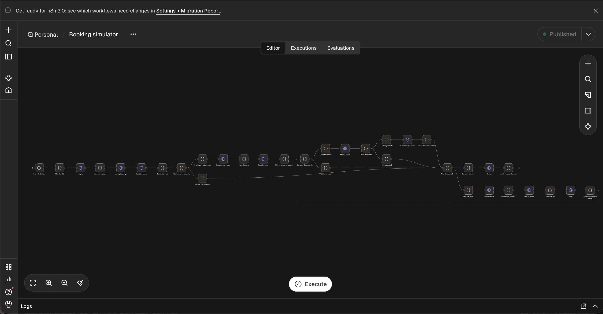
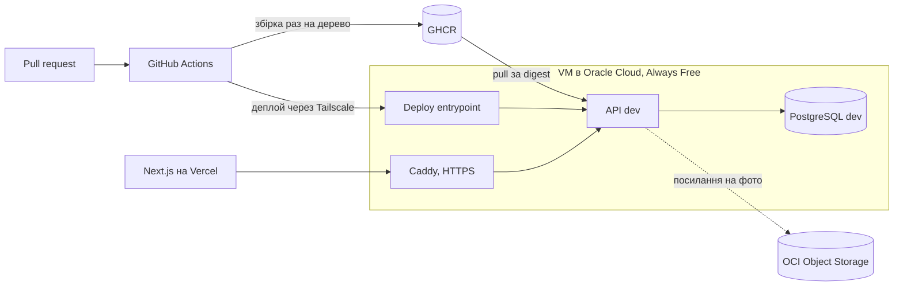

# Backend Showcase

[English](README.md) | Українська

[](https://github.com/VladSkopenko/backend-showcase/actions/workflows/ci.yml)
[](https://sonarcloud.io/summary/new_code?id=VladSkopenko_backend-showcase)
[](https://sonarcloud.io/summary/new_code?id=VladSkopenko_backend-showcase)
[](https://sonarcloud.io/summary/new_code?id=VladSkopenko_backend-showcase)
[](https://sonarcloud.io/summary/new_code?id=VladSkopenko_backend-showcase)

REST API для мережі ресторанів: бронювання столиків, яке витримує паралельні запити, сесії з ротацією
refresh-токенів, групове передзамовлення і AI-асистент, що діє через картки з підтвердженням. Його
постачено так, як постачають продакшн-сервіси: перевірки якості в CI, образи, що збираються один раз і
просуваються за digest, інфраструктура як код і реальний сервер, усе на безкоштовних тарифах. Ресторан —
це предметна область; мета — весь шлях від pull request до сервера під моніторингом.

## З чого почати

| На що подивитися | Де |
|---|---|
| Подвійне бронювання за паралельних запитів: блокується рядок користувача, потім рядок столу, а exclusion constraint їх підстраховує ([ADR 13](docs/adr/0013-table-booking-slots-and-double-booking.md)) | `BookingService.create` і `edit` у [booking_service.py](backend/src/app/features/core/bookings/services/booking_service.py) |
| Тест, що зіштовхує дві справжні транзакції з цими блокуваннями | [test_booking_concurrency.py](backend/tests/test_booking_concurrency.py) |
| Ротація refresh-токенів: два оновлення одного токена йдуть по черзі, а повторно використаний токен відкликає всі сесії користувача | `SessionService.refresh` у [session_service.py](backend/src/app/features/core/auth/services/session_service.py) |
| Порушення обмежень бази перетворюються на доменні помилки за назвою обмеження | [constraint_errors.py](backend/src/app/common/constraint_errors.py) |
| Правила шарів і фіч, які перевіряє CI | `[tool.importlinter]` у [pyproject.toml](backend/pyproject.toml), [ADR 11](docs/adr/0011-feature-sliced-backend-layout.md) |

## Спробувати

| Що | Посилання |
|---|---|
| API на dev | https://backend-showcase-dev.duckdns.org/health |
| Документація API (Swagger) | https://backend-showcase-dev.duckdns.org/docs |
| Фронтенд | https://family-rest.vercel.app, код у [LudSkop/family-rest](https://github.com/LudSkop/family-rest) |
| Дашборди (Grafana, без облікового запису) | https://backend-showcase-grafana.duckdns.org |
| Якість коду (SonarCloud) | https://sonarcloud.io/summary/overall?id=VladSkopenko_backend-showcase |

Проєкт працює в одному середовищі, dev, і на ньому завершується
([ADR 24](docs/adr/0024-the-project-ends-on-dev.md)).

## Що вже зроблено

| Напрям | Що працює зараз |
|---|---|
| CI | Кожен pull request запускає ruff, mypy, архітектурні контракти (import-linter), прогін міграцій туди й назад з `alembic check` і pytest на справжньому PostgreSQL |
| Образи | Багатоетапний Dockerfile з користувачем без root і healthcheck. Кожне git-дерево збирається один раз на arm64-раннері, перевіряється Trivy і потрапляє в GHCR ([ADR 4](docs/adr/0004-image-identity-and-promotion.md)) |
| Деплой | Merge у `main` розгортає dev без ручних кроків. CI дістається сервера лише через Tailscale, а forced-command entrypoint розгортає тільки коміти з гілки середовища ([ADR 2](docs/adr/0002-ci-access-through-tailscale.md), [ADR 3](docs/adr/0003-deploy-entrypoint-verifies-commit.md)) |
| Інфраструктура | Terraform для VM в Oracle Cloud, мережі, диска з даними, бакета для медіа та його IAM; cloud-init для базової ОС; сервер замінюють, а не латають ([ADR 8](docs/adr/0008-terraform-and-immutable-server.md)) |
| Платформа | Caddy з автоматичним HTTPS перед app-стеками; одна VM, platform-стек і окремий app-стек для кожного середовища ([ADR 7](docs/adr/0007-single-vm-platform-and-app-stacks.md)). Prometheus у platform-стеку збирає метрики запитів dev API; його UI доступний лише в tailnet, за адресою `https://backend-showcase-platform.tail88eb36.ts.net:9090` ([ADR 22](docs/adr/0022-prometheus-scrapes-dev.md)) |
| API | Реєстрація з підтвердженням email, JWT-сесії з ротацією refresh-токенів, скидання пароля, вхід через Google, меню з фото в Object Storage, локації ресторанів зі столами, бронювання столів із сіткою слотів і захистом від подвійного бронювання, зміна бронювання (час, гості, тривалість), запрошення за посиланням для друзів з акаунтом і без, кошик передзамовлення для кожного учасника і передзамовлення всієї компанії для власника бронювання. Чат з AI-асистентом відповідає потоком мовою гостя про меню, локації, вільні столи, власні бронювання й передзамовлення гостя, а також бронює, змінює чи скасовує бронювання, змінює кошик передзамовлення й надсилає передзамовлення гостя через картки, які гість підтверджує, у межах одного денного бюджету на всю систему |
| Симуляція | n8n у platform-стеку відтворює роботу ресторану на dev: [симулятор бронювань](n8n/workflows/booking-simulator.json) (40 ботів-гостей кожні 2 хвилини бронюють, надсилають запити на великі компанії, передзамовляють і скасовують) і [бот-офіціант](n8n/workflows/waiter-bot.json) (staff-бот схвалює або відхиляє запити). Редактор доступний лише в tailnet, за адресою `https://backend-showcase-platform.tail88eb36.ts.net:5678` ([ADR 14](docs/adr/0014-booking-simulator-on-dev.md), [n8n/README.md](n8n/README.md)) |
| Дашборди | Публічна Grafana відкривається без облікового запису на п'яти дашбордах із живими даними dev: бронювання, страви, чеки, відвідувачі та рішення персоналу, а також на дашборді API з живою частотою запитів, часткою 5xx і затримкою dev API з Prometheus ([ADR 22](docs/adr/0022-prometheus-scrapes-dev.md)). Дашборди лежать JSON-файлами в [deploy/platform/grafana/dashboards](deploy/platform/grafana/dashboards) і підхоплюються під час деплою; Grafana читає dev через роль бази, яка не бачить email, хешів і токенів, а тест виконує запит кожної SQL-панелі під цією роллю ([ADR 19](docs/adr/0019-public-grafana-reads-dev.md)) |

### Симуляція на dev

| Бот-офіціант | Симулятор бронювань | Запуски |
|---|---|---|
|  |  |  |

## Архітектура



## Як коміт потрапляє на dev

1. Pull request у `main` запускає перевірки CI.
2. Після merge workflow delivery збирає образ для git-дерева, якщо цього дерева ще немає в GHCR, і
   перевіряє його Trivy.
3. Job деплою підключається до tailnet і викликає entrypoint на сервері з комітом.
4. Entrypoint перевіряє, що коміт є в `main`, завантажує образ, виконує `alembic upgrade head` і
   запускає API, чекаючи на його healthcheck.

## Будова бекенду

- Python 3.14, FastAPI, Pydantic v2, SQLAlchemy 2 async, Alembic, uv.
- Feature-sliced структура ([ADR 11](docs/adr/0011-feature-sliced-backend-layout.md)). Core-фічі
  (users, auth, health, menu, locations, bookings) спільні для всіх. Звичайні фічі ніколи не імпортують одна
  одну. Усередині фічі виклики йдуть `endpoints → services → repositories → models`. import-linter
  перевіряє ці правила в CI.
- Довідкові дані, як-от меню й локації, постачаються міграціями, тож кожне середовище отримує їх без
  доступу до сервера.
- Swagger групує маршрути за сценаріями користувача (Registration, Session, Menu, Locations, Booking,
  Invites, Pre-order), а не за модулями.
- Тести працюють зі справжньою PostgreSQL, кожен відкочується через savepoint, бо важливі правила
  тримаються на блокуваннях рядків і обмеженнях, які мок сесії перевірити не може.
- Вхід блокує акаунт після кількох неправильних паролів. Ліміту за IP навмисно немає: фронтенд
  надсилає вхід через свій сервер Next.js на Vercel, тож API бачить адреси Vercel, а не гостей.

## Рішення

Кожен неочевидний вибір має короткий запис у [docs/adr](docs/adr):

| ADR | Рішення |
|---|---|
| [2](docs/adr/0002-ci-access-through-tailscale.md) | CI дістається сервера лише через Tailscale |
| [3](docs/adr/0003-deploy-entrypoint-verifies-commit.md) | Entrypoint деплою приймає коміт і перевіряє його |
| [4](docs/adr/0004-image-identity-and-promotion.md) | Образи ідентифікуються хешем дерева й розгортаються за digest; змінено ADR 24: лише dev |
| [5](docs/adr/0005-migration-rollback-with-alembic.md) | Замінено ADR 24. Невдалий деплой відкочує міграції через Alembic |
| [6](docs/adr/0006-data-stack-per-environment.md) | Кожне середовище має власну PostgreSQL; змінено ADR 24: лише dev, без Redis |
| [7](docs/adr/0007-single-vm-platform-and-app-stacks.md) | Одна VM запускає platform-стек і app-стек; змінено ADR 24: один app-стек, dev |
| [8](docs/adr/0008-terraform-and-immutable-server.md) | Terraform з самого початку, сервер незмінний |
| [9](docs/adr/0009-alerting-from-outside-the-vm.md) | Замінено ADR 23. Алерти мають працювати, навіть коли VM не працює |
| [10](docs/adr/0010-frontend-in-a-separate-repository.md) | Фронтенд живе в окремому репозиторії |
| [11](docs/adr/0011-feature-sliced-backend-layout.md) | Feature-sliced структура бекенду |
| [12](docs/adr/0012-unified-error-response.md) | Один формат відповіді з помилкою для всього API |
| [13](docs/adr/0013-table-booking-slots-and-double-booking.md) | Фіксовані слоти бронювання; блокування рядків і exclusion constraint не дають забронювати столик двічі |
| [14](docs/adr/0014-booking-simulator-on-dev.md) | n8n імітує відвідувачів лише на dev, боти з'являються з міграції, що залежить від середовища |
| [15](docs/adr/0015-platform-as-code.md) | Платформа як код: merge у `main` розгортає всю платформу |
| [16](docs/adr/0016-booking-participants-and-guest-identity.md) | Учасники бронювання в core, запрошення як regular-фіча, гості за cookie з хешованим токеном |
| [17](docs/adr/0017-preorder-parts-per-participant.md) | Чернетки передзамовлення кожного учасника, що надсилаються в одну групу, перегляд усієї компанії власником, актуальні ціни, вікно спільне з приєднанням і блокування бронювання |
| [18](docs/adr/0018-in-app-notifications.md) | Замінено ADR 21. Сповіщення в застосунку записуються в транзакції рішення, листи надсилаються після коміту, окремі домени пропускаються |
| [19](docs/adr/0019-public-grafana-reads-dev.md) | Публічна Grafana читає dev через роль, обмежену переліченими колонками; межею безпеки є сама роль |
| [20](docs/adr/0020-assistant-composes-ai-tools.md) | AI-інструменти фічі живуть в `ai_tools/` поряд з її endpoints як другий адаптер над її сервісами; асистент є їхнім єдиним місцем збирання |
| [21](docs/adr/0021-decisions-by-email-only.md) | Рішення персоналу доходять до гостей лише листом; список сповіщень у застосунку прибрано |
| [22](docs/adr/0022-prometheus-scrapes-dev.md) | Prometheus у platform-стеку збирає метрики dev з `env` із власного конфігу, UI у tailnet; межею порту метрик є Caddy |
| [23](docs/adr/0023-observability-ends-with-logs.md) | Спостережуваність завершується логами: без алертів, watchdog, трейсів і Redis exporter |
| [24](docs/adr/0024-the-project-ends-on-dev.md) | Проєкт завершується на dev: без staging і production, відкату міграцій, Redis, бекапів і навантажувальних тестів |

## Запуск локально

З `backend/`:

```bash
uv sync
docker compose up -d                       # PostgreSQL на 127.0.0.1:5433
uv run alembic upgrade head
uv run uvicorn app.main:create_app --factory --port 8000    # http://127.0.0.1:8000/docs
uv run pytest
```

## Робота за $0

| Потреба | Безкоштовний варіант |
|---|---|
| Сервер | Oracle Cloud Always Free, одна VM Ampere A1 (Arm) |
| CI/CD і реєстр | GitHub Actions і GHCR у публічному репозиторії |
| Домени й HTTPS | Піддомени DuckDNS, Caddy з Let's Encrypt |
| State Terraform, фото | OCI Object Storage |
| Приватний доступ | Tailscale |

## Як це зроблено

Систему проєктую і рішення ухвалюю я; більшу частину коду пише Claude Code за правилами, які я задав,
а кожну зміну я переглядаю перед злиттям.

- **Рішення мої:** feature-sliced шари та їхні контракти import-linter, об'єктно-орієнтований стиль,
  один формат помилок для всього API, тести на справжній базі, дизайн блокувань і токенів.
  Продуктові правила підписані в специфікаціях як "Decisions (Vlad, дата)" у
  [`_bmad_output/`](_bmad_output/implementation-artifacts).
- **Агент працює в межах правил, які написав я:** [`CLAUDE.md`](CLAUDE.md) і
  [`.claude/rules/`](.claude/rules) (спершу специфікація, спершу тести, що падають, кожен ключ
  конфігурації звіряється з офіційною документацією) та [`.claude/settings.json`](.claude/settings.json)
  (зміни в git і міграції потребують підтвердження, секрети ніколи не читаються).
- **Я виправляю агента, коли він помиляється:** він пропонував прийняти справжні знахідки SonarCloud
  замість того, щоб виправити їх ([6469d44](https://github.com/VladSkopenko/backend-showcase/commit/6469d443e3d70c825addd68847c85af33775926f)
  виправив усі), і замінив назви подій асистента на «магічні рядки», щоб заглушити правило
  ([#58](https://github.com/VladSkopenko/backend-showcase/pull/58) зробив їх enum).
- Інфраструктуру я опанував на цьому проєкті, будуючи її разом з агентом: CI/CD, Docker, Terraform,
  Tailscale, Prometheus і Grafana.

## Що залишилося

- Метрики PostgreSQL на dev, далі логи у VictoriaLogs. Після цього проєкт завершено
  ([ADR 23](docs/adr/0023-observability-ends-with-logs.md),
  [ADR 24](docs/adr/0024-the-project-ends-on-dev.md)).

План, зокрема що зроблено і від чого відмовилися, у [docs/roadmap.md](docs/roadmap.md).
