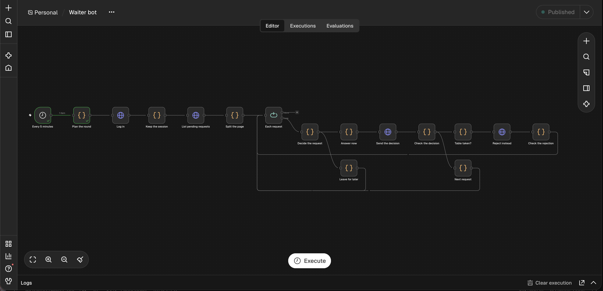
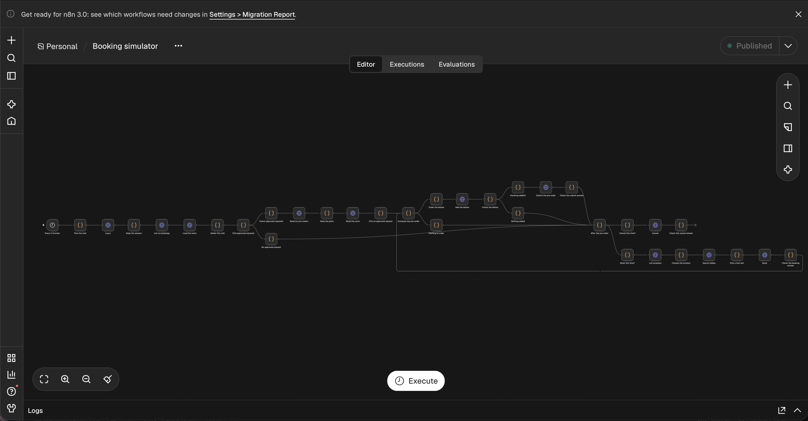
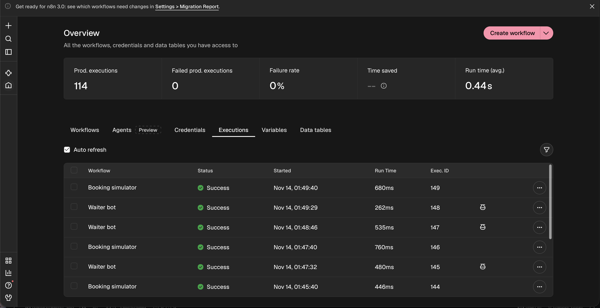
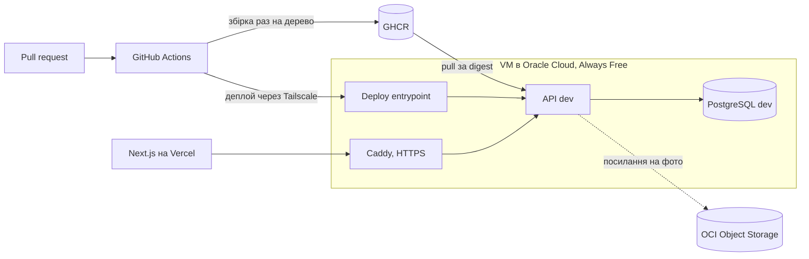

# Backend Showcase

[English](README.md) | Українська

[](https://github.com/VladSkopenko/backend-showcase/actions/workflows/ci.yml)

REST API для мережі ресторанів. Проєкт показує повний цикл поставки: перевірки якості в CI, образи,
що збираються один раз і просуваються за digest, інфраструктуру як код і реальний сервер. Усе працює
на безкоштовних тарифах.

## Спробувати

| Що | Посилання |
|---|---|
| API на dev | https://backend-showcase-dev.duckdns.org/health |
| Документація API (Swagger) | https://backend-showcase-dev.duckdns.org/docs |
| Фронтенд | https://family-rest.vercel.app, код у [LudSkop/family-rest](https://github.com/LudSkop/family-rest) |

Для staging і production уже є гілки (`rc`, `prod`) і домени. Вони запрацюють із першим релізом.

## Що вже зроблено

| Напрям | Що працює зараз |
|---|---|
| CI | Кожен pull request запускає ruff, mypy, архітектурні контракти (import-linter), прогін міграцій туди й назад з `alembic check` і pytest на справжньому PostgreSQL |
| Образи | Багатоетапний Dockerfile з користувачем без root і healthcheck. Кожне git-дерево збирається один раз на arm64-раннері, перевіряється Trivy і потрапляє в GHCR ([ADR 4](docs/adr/0004-image-identity-and-promotion.md)) |
| Деплой | Merge у `main` розгортає dev без ручних кроків. CI дістається сервера лише через Tailscale, а forced-command entrypoint розгортає тільки коміти з гілки середовища ([ADR 2](docs/adr/0002-ci-access-through-tailscale.md), [ADR 3](docs/adr/0003-deploy-entrypoint-verifies-commit.md)) |
| Інфраструктура | Terraform для VM в Oracle Cloud, мережі, диска з даними, бакета для медіа та його IAM; cloud-init для базової ОС; сервер замінюють, а не латають ([ADR 8](docs/adr/0008-terraform-and-immutable-server.md)) |
| Платформа | Caddy з автоматичним HTTPS перед app-стеками; одна VM, platform-стек і окремий app-стек для кожного середовища ([ADR 7](docs/adr/0007-single-vm-platform-and-app-stacks.md)) |
| API | Реєстрація з підтвердженням email, JWT-сесії з ротацією refresh-токенів, скидання пароля, вхід через Google, меню з фото в Object Storage, локації ресторанів зі столами, бронювання столів із сіткою слотів і захистом від подвійного бронювання, зміна бронювання (час, гості, тривалість), запрошення за посиланням для друзів з акаунтом і без, кошик передзамовлення для кожного учасника |
| Симуляція | n8n у platform-стеку відтворює роботу ресторану на dev: [симулятор бронювань](n8n/workflows/booking-simulator.json) (40 ботів-гостей кожні 2 хвилини бронюють, надсилають запити на великі компанії, передзамовляють і скасовують) і [бот-офіціант](n8n/workflows/waiter-bot.json) (staff-бот схвалює або відхиляє запити). Редактор доступний лише в tailnet, за адресою `https://backend-showcase-platform.tail88eb36.ts.net:5678` ([ADR 14](docs/adr/0014-booking-simulator-on-dev.md), [n8n/README.md](n8n/README.md)) |

### Симуляція на dev

| Бот-офіціант | Симулятор бронювань | Запуски |
|---|---|---|
|  |  |  |

## Архітектура



## Як коміт потрапляє на dev

1. Pull request у `main` запускає перевірки CI.
2. Після merge workflow delivery збирає образ для git-дерева, якщо цього дерева ще немає в GHCR, і
   перевіряє його Trivy.
3. Job деплою підключається до tailnet і викликає entrypoint на сервері з комітом.
4. Entrypoint перевіряє, що коміт є в `main`, завантажує образ, виконує `alembic upgrade head` і
   запускає API, чекаючи на його healthcheck.

Staging і production отримуватимуть той самий образ за digest через pull requests з `main` у `rc`
і з `rc` у `prod` ([ADR 4](docs/adr/0004-image-identity-and-promotion.md)). Їхні jobs деплою
з'являться з першим релізом.

## Будова бекенду

- Python 3.14, FastAPI, Pydantic v2, SQLAlchemy 2 async, Alembic, uv.
- Feature-sliced структура ([ADR 11](docs/adr/0011-feature-sliced-backend-layout.md)). Core-фічі
  (users, auth, health, menu, locations, bookings) спільні для всіх. Звичайні фічі ніколи не імпортують одна
  одну. Усередині фічі виклики йдуть `endpoints → services → repositories → models`. import-linter
  перевіряє ці правила в CI.
- Довідкові дані, як-от меню й локації, постачаються міграціями, тож кожне середовище отримує їх без
  доступу до сервера.
- Swagger групує маршрути за сценаріями користувача (Registration, Session, Menu, Locations, Booking,
  Invites, Pre-order), а не за модулями.

## Рішення

Кожен неочевидний вибір має короткий запис у [docs/adr](docs/adr):

| ADR | Рішення |
|---|---|
| [2](docs/adr/0002-ci-access-through-tailscale.md) | CI дістається сервера лише через Tailscale |
| [3](docs/adr/0003-deploy-entrypoint-verifies-commit.md) | Entrypoint деплою приймає коміт і перевіряє його |
| [4](docs/adr/0004-image-identity-and-promotion.md) | Образи ідентифікуються хешем дерева й просуваються за digest |
| [5](docs/adr/0005-migration-rollback-with-alembic.md) | Невдалий деплой відкочує міграції через Alembic |
| [6](docs/adr/0006-data-stack-per-environment.md) | Кожне середовище має власні PostgreSQL і Redis |
| [7](docs/adr/0007-single-vm-platform-and-app-stacks.md) | Одна VM запускає platform-стек і app-стек для кожного середовища |
| [8](docs/adr/0008-terraform-and-immutable-server.md) | Terraform з самого початку, сервер незмінний |
| [9](docs/adr/0009-alerting-from-outside-the-vm.md) | Алерти мають працювати, навіть коли VM не працює |
| [10](docs/adr/0010-frontend-in-a-separate-repository.md) | Фронтенд живе в окремому репозиторії |
| [11](docs/adr/0011-feature-sliced-backend-layout.md) | Feature-sliced структура бекенду |
| [12](docs/adr/0012-unified-error-response.md) | Один формат відповіді з помилкою для всього API |
| [13](docs/adr/0013-table-booking-slots-and-double-booking.md) | Фіксовані слоти бронювання; блокування рядків і exclusion constraint не дають забронювати столик двічі |
| [14](docs/adr/0014-booking-simulator-on-dev.md) | n8n імітує відвідувачів лише на dev, боти з'являються з міграції, що залежить від середовища |
| [15](docs/adr/0015-platform-as-code.md) | Платформа як код: merge у `main` розгортає всю платформу |
| [16](docs/adr/0016-booking-participants-and-guest-identity.md) | Учасники бронювання в core, запрошення як regular-фіча, гості за cookie з хешованим токеном |
| [17](docs/adr/0017-preorder-parts-per-participant.md) | Чернетки передзамовлення кожного учасника, що надсилаються в одну групу, актуальні ціни, вікно спільне з приєднанням і блокування бронювання |
| [18](docs/adr/0018-in-app-notifications.md) | Сповіщення в застосунку записуються в транзакції рішення, листи надсилаються після коміту, окремі домени пропускаються |

## Запуск локально

З `backend/`:

```bash
uv sync
docker compose up -d                       # PostgreSQL на 127.0.0.1:5433
uv run alembic upgrade head
uv run uvicorn app.main:app --port 8000    # http://127.0.0.1:8000/docs
uv run pytest
```

## Робота за $0

| Потреба | Безкоштовний варіант |
|---|---|
| Сервер | Oracle Cloud Always Free, одна VM Ampere A1 (Arm) |
| CI/CD і реєстр | GitHub Actions і GHCR у публічному репозиторії |
| Домени й HTTPS | Піддомени DuckDNS, Caddy з Let's Encrypt |
| State, бекапи, фото | OCI Object Storage |
| Приватний доступ | Tailscale |

## Розробка з AI-агентами

Репозиторій створено з Claude Code і методом BMAD, і це налаштування теж частина проєкту. `CLAUDE.md`
і `.claude/rules/` задають процес: спершу специфікація, потім тести, незалежні рев'ю і перевірка
наживо. `.claude/settings.json` додає запобіжники: зміни в git і міграції потребують підтвердження,
секрети ніколи не читаються. Кожна фіча починається зі специфікації в `_bmad_output/`.
Інфраструктуру написано вручну.

## Що далі

- Спостережуваність: метрики, дашборди, логи й алерти в Telegram
- Живі staging і production з відкатом міграцій при невдалому деплої
- Бронювання столів, кошик і замовлення як скінченний автомат з трекером наживо
- Навантажувальні тести k6 з опублікованими цифрами

Повний план у [docs/roadmap.md](docs/roadmap.md).
