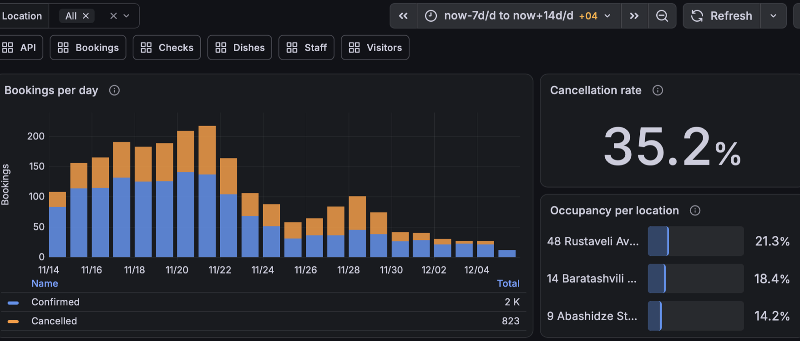
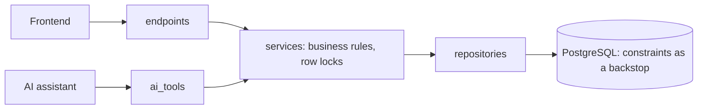
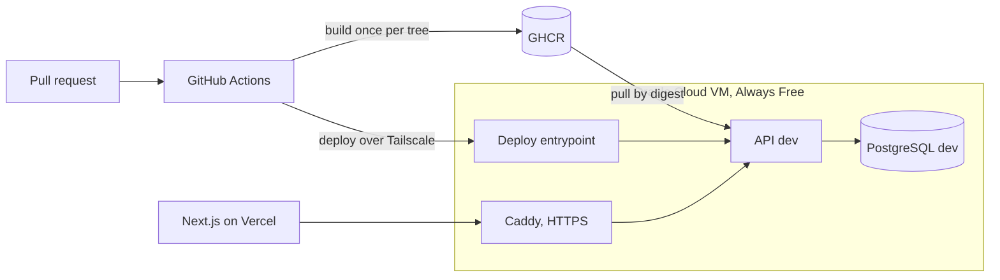
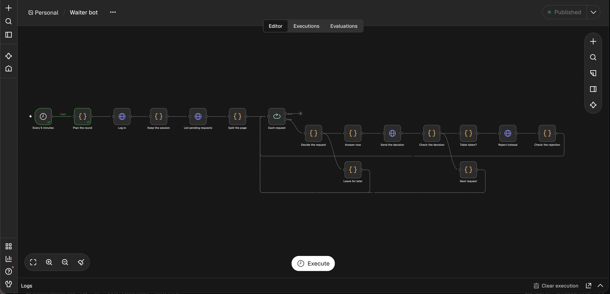
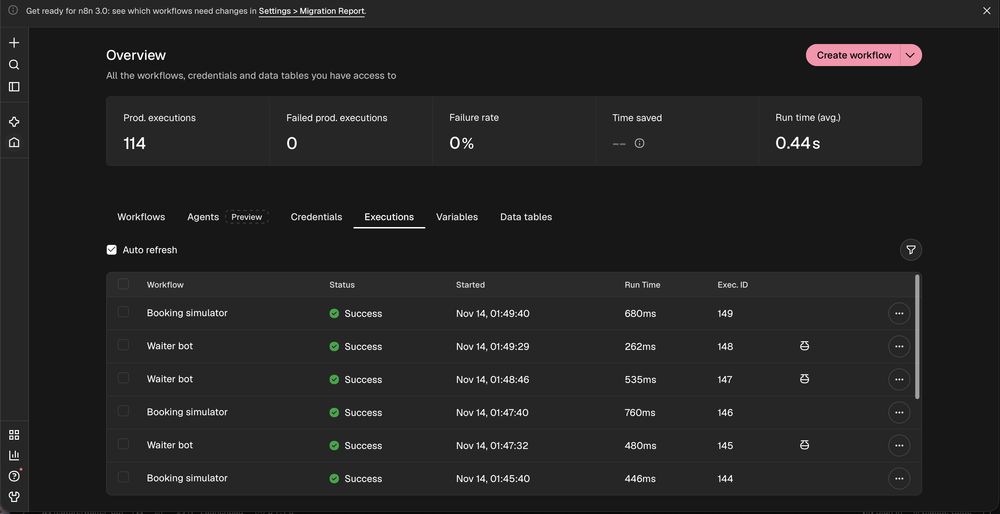
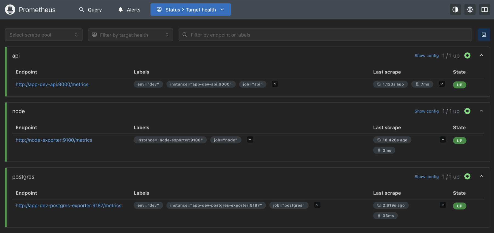
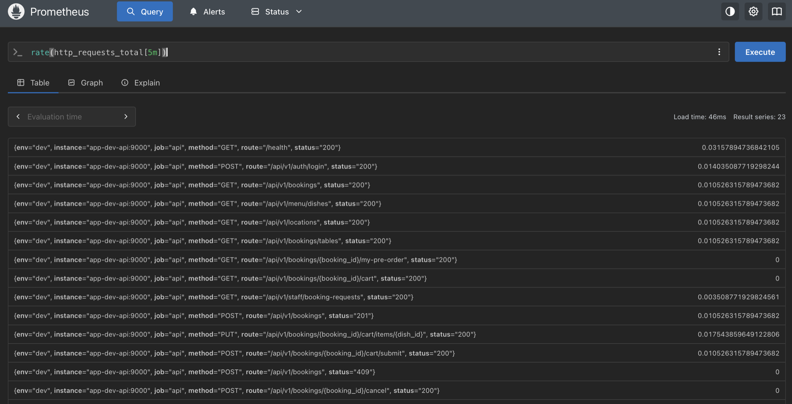
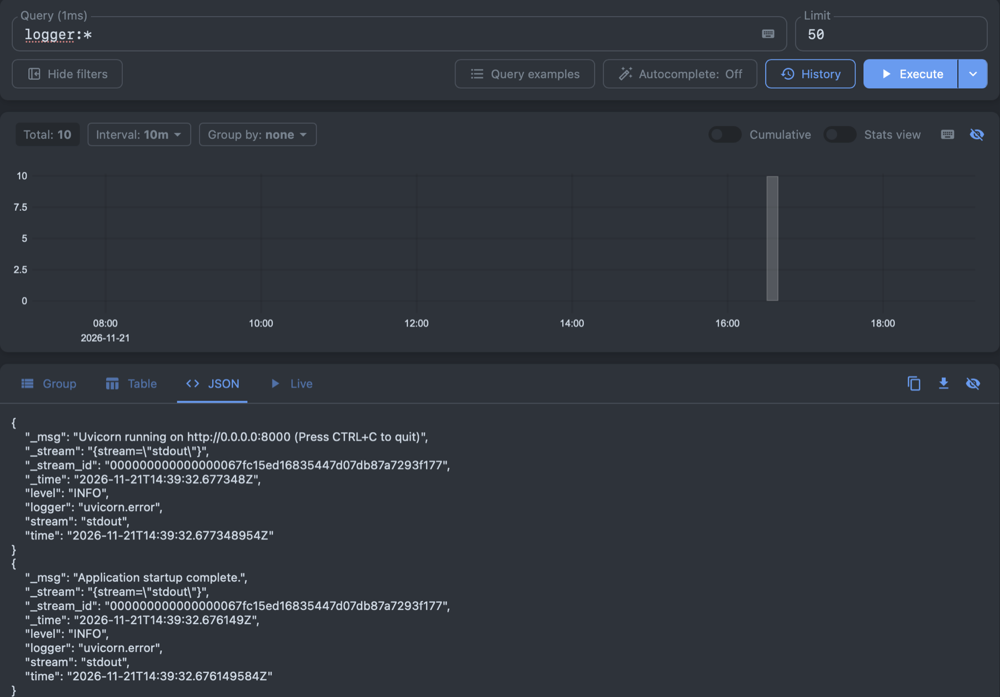

# Backend Showcase

[English](README.md) | Українська

[](https://github.com/VladSkopenko/backend-showcase/actions/workflows/ci.yml)
[](https://sonarcloud.io/summary/new_code?id=VladSkopenko_backend-showcase)
[](https://sonarcloud.io/summary/new_code?id=VladSkopenko_backend-showcase)

Дві речі в одному репозиторії: **бекенд** ресторану (гості бронюють столи, запрошують друзів,
роблять передзамовлення та спілкуються з AI-асистентом) і **хмара та CI/CD**, на яких він живе на
справжньому сервері: деплой з `main` без ручних кроків, моніторинг і нуль витрат.

## Наживо

| Що | Посилання |
|---|---|
| Фронтенд | https://family-rest.vercel.app ([код](https://github.com/LudSkop/family-rest)) |
| Документація API (Swagger) | https://backend-showcase-dev.duckdns.org/docs |
| Дашборди, без акаунта | https://backend-showcase-grafana.duckdns.org |
| Якість коду | https://sonarcloud.io/summary/overall?id=VladSkopenko_backend-showcase |
| Prometheus, лише через Tailscale | https://backend-showcase-platform.tail88eb36.ts.net:9090 |
| Логи (VictoriaLogs), лише через Tailscale | https://backend-showcase-platform.tail88eb36.ts.net:9428/select/vmui/ |

Боти в n8n цілодобово грають ресторан: гості бронюють, роблять передзамовлення та скасовують, а бот
офіціанта вирішує запити великих компаній, тож дашборди завжди живі.



---

## Частина 1. Бекенд

### Що він уміє

- Реєстрація з підтвердженням email або через Google; сесії з ротацією refresh-токенів.
- Бронювання столу за сіткою слотів, безпечне за одночасних запитів; зміна чи скасування броні.
- Запрошення друзів за посиланням, з акаунтом або без.
- Передзамовлення для кожного гостя та замовлення всієї компанії для власника броні.
- Персонал схвалює або відхиляє запити великих компаній.
- AI-асистент відповідає про меню та бронювання і діє лише через картки, які гість підтверджує.

### Як він побудований



- Python 3.14, FastAPI, SQLAlchemy 2 async, Alembic.
- Feature-sliced структура: core-фічі (users, auth, menu, locations, bookings) спільні, звичайні фічі
  ніколи не імпортують одна одну, а виклики йдуть в один бік: endpoints, потім services, потім
  repositories. import-linter перевіряє це в CI.
- Один формат помилок для всього API.
- Тести йдуть на справжньому PostgreSQL, бо важливі правила тримаються на блокуваннях рядків і обмеженнях.

### Куди дивитися в коді

| Що | Де |
|---|---|
| Подвійне бронювання за одночасних запитів: блокування рядків плюс exclusion constraint | [booking_service.py](backend/src/app/features/core/bookings/services/booking_service.py) |
| Тест, у якому змагаються дві справжні транзакції | [test_booking_concurrency.py](backend/tests/test_booking_concurrency.py) |
| Ротація refresh-токенів; повторно використаний токен відкликає всі сесії | [session_service.py](backend/src/app/features/core/auth/services/session_service.py) |
| Помилки бази перетворюються на доменні за назвою обмеження | [constraint_errors.py](backend/src/app/common/constraint_errors.py) |

---

## Частина 2. Хмара та CI/CD

### Як коміт потрапляє на сервер



### На чому це працює

| Частина | Як |
|---|---|
| CI | ruff, mypy, import-linter, перевірка міграцій туди й назад і pytest на справжньому PostgreSQL для кожного pull request |
| Доставка | Один образ на кожне дерево git, перевірений Trivy, деплой за digest; CI дістається сервера лише через Tailscale |
| Сервер | VM в Oracle Cloud, мережа та сховище в Terraform; сервер замінюють, а не латають |
| Платформа | Caddy, n8n, Prometheus, Grafana і VictoriaLogs як код, деплой на кожен merge |
| Моніторинг | Prometheus збирає метрики API, сервера та бази; публічна Grafana показує трафік API та цифри ресторану |
| Логи | Fluent Bit відправляє логи всіх контейнерів у VictoriaLogs, доступний лише через Tailscale |
| Вартість | $0: Oracle Always Free, GitHub Actions і GHCR, DuckDNS, Tailscale |

### Як це виглядає

<details>
<summary>n8n: симулятор гостей, бот офіціанта та їхні запуски</summary>





</details>

<details>
<summary>Prometheus: три цілі збору та запити до API за маршрутами</summary>




</details>

<details>
<summary>VictoriaLogs: логи API у вигляді структурованого JSON</summary>



</details>

---

## Локальний запуск

З теки `backend/`:

```bash
uv sync
docker compose up -d                       # PostgreSQL на 127.0.0.1:5433
uv run alembic upgrade head
uv run uvicorn app.main:create_app --factory --port 8000    # http://127.0.0.1:8000/docs
uv run pytest
```
