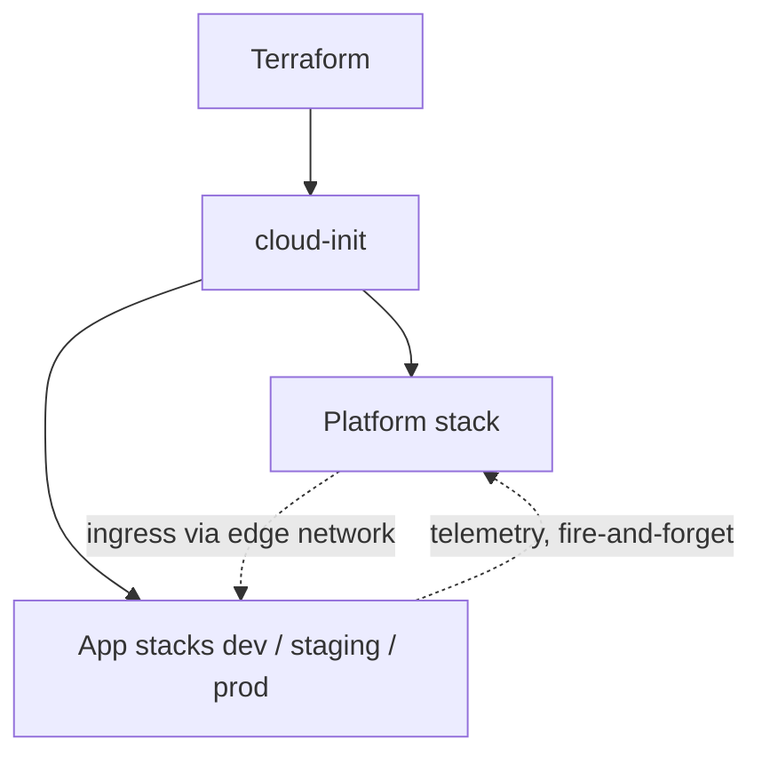
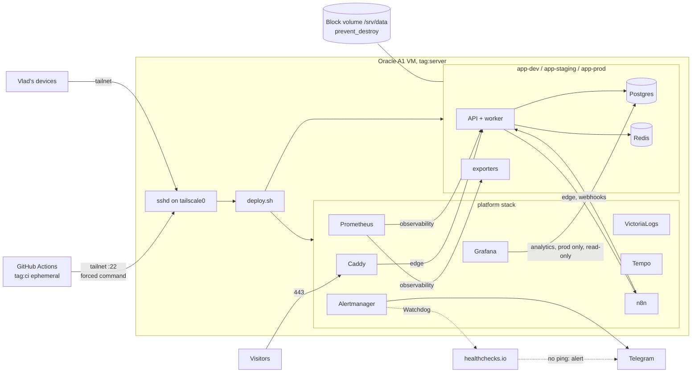
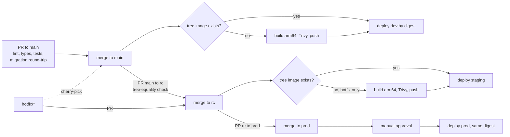
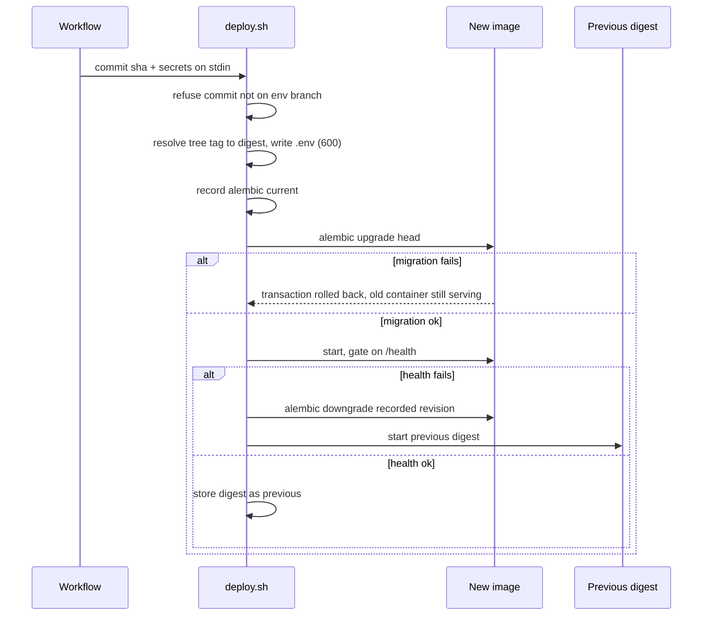

# Architecture Spine: backend-showcase deployment and infrastructure

## Design Paradigm

Immutable single-host infrastructure. Each layer has exactly one owner and nothing on the VM is changed by hand.

| Layer | Owner | Lives in |
| --- | --- | --- |
| Machine, network, firewall, data volume | Terraform | `deploy/terraform/` |
| Base OS: Docker, Tailscale, `deploy` user, sshd, mounts | cloud-init, first boot only | `deploy/terraform/` (`user_data`) |
| Platform stack: Caddy, Prometheus, Grafana, VictoriaLogs, Tempo, Alertmanager, n8n | platform workflow | `deploy/platform/` |
| App stack per environment: API, worker, Postgres, Redis, exporters | delivery pipeline | `deploy/app/` |

Delivery is build-once, promote-by-digest: a source tree becomes one image, and environments differ only in which digest and `.env` they run.



A solid arrow means the lower layer cannot exist without the upper one. Dotted arrows are runtime traffic only: an app stack must start and serve with the platform stack down.

## Invariants & Rules

### AD-1: Two layers on one VM [ADOPTED]

- **Binds:** phase-3, phase-4
- **Prevents:** an app deploy restarting monitoring or n8n, and environments sharing state.
- **Rule:** The platform stack is one compose project, deployed once and changed only by its own workflow. Each environment is its own compose project `app-<env>` with its own network, database, Redis and `.env`. An app deploy touches only its own project.

### AD-2: One owner per layer, no manual changes [ADOPTED]

- **Binds:** phase-3, phase-5
- **Prevents:** configuration drift between the VM and the repo, and a server that cannot be recreated.
- **Rule:** Terraform owns the machine, cloud-init the base OS, pipelines the stacks. A base OS change means replacing the VM (`terraform apply -replace` on the instance), never editing it over SSH. Minimal Terraform (VCN, subnet, security list, VM, data volume) lands at the start of Phase 3.

### AD-3: Public surface is 80/443 only [ADOPTED]

- **Binds:** phase-3, phase-4, phase-5
- **Prevents:** exposing SSH or internal UIs to the internet.
- **Rule:** The OCI security list opens only TCP 80 and 443, both terminated by Caddy. Public hosts are the dev, staging and prod API hosts and Grafana. Prometheus, Alertmanager, VictoriaLogs, Tempo and n8n are reachable only over the tailnet. Port 22 is never open publicly.

### AD-4: CI reaches the VM only through Tailscale [ADOPTED]

- **Binds:** all deploy workflows, Terraform network, tailnet policy
- **Prevents:** long-lived CI credentials and a broad network path from CI to the server.
- **Rule:** Workflows join the tailnet with `tailscale/github-action@v4` using workload identity federation as an ephemeral node tagged `tag:ci`. The tailnet policy allows `tag:ci` to reach only `tag:server:22`. The server joins once at first boot with a one-off, pre-authorized, short-lived auth key.

### AD-5: One deploy entrypoint behind a forced command [ADOPTED]

- **Binds:** deploy workflows, cloud-init, `deploy/*/deploy.sh`
- **Prevents:** a leaked deploy key giving a shell or running caller-supplied compose files (the `docker` group is root-equivalent), and a dev key deploying to prod.
- **Rule:** sshd listens only on `tailscale0`. The `deploy` user's `authorized_keys` has one key per target (`dev`, `staging`, `prod`, `platform`), each with a forced command that runs the entrypoint for that target only. The entrypoint, installed by cloud-init, accepts a single argument: a commit sha. It keeps a clone of the public repo, fetches the target's branch, refuses any commit not reachable from that branch (`git merge-base --is-ancestor`), and runs `deploy/<app|platform>/deploy.sh` from that commit. Compose files and deploy logic therefore always come from a protected branch, never from the caller. Secrets come from GitHub Environments over SSH stdin and are written to the target's `.env` with mode 600; they never appear in argv or logs. Break-glass access is the OCI serial console, described in a runbook and tested once.

### AD-6: Image identity is the git tree hash [ADOPTED]

- **Binds:** build and promotion workflows
- **Prevents:** promotion failing to find an image after a merge commit, or silently deploying the wrong code.
- **Rule:** Images are tagged `tree-<git rev-parse HEAD^{tree}>` and `sha-<commit>`, and carry the label `org.opencontainers.image.revision`. Any environment's pipeline resolves the tree tag first. If the image exists it is reused; otherwise it is built for `linux/arm64`, scanned with Trivy, and pushed to GHCR. Each tree is built at most once. A promotion that finds no image fails with an explicit message and does not wait.

### AD-7: Deploy by digest [ADOPTED]

- **Binds:** deploy workflows, `deploy/app/deploy.sh`
- **Prevents:** a mutable GHCR tag changing what runs, and rollback by guesswork.
- **Rule:** `deploy.sh` computes the tree tag from the verified commit and resolves it once to `image@sha256:<digest>`. It writes the digest to the environment's `.env` and prints it, so the workflow puts it in the job summary. It keeps the previous digest on the VM; rollback means starting that digest.

### AD-8: Branch promotion and hotfixes [ADOPTED]

- **Binds:** rulesets, required status checks, release process
- **Prevents:** promoting code that never ran in a lower environment, and losing a hotfix from `main`.
- **Rule:** `main` deploys to dev, `rc` to staging, `prod` to production after manual approval in GitHub Environments. `rc` accepts PRs only from `main` or `hotfix/*`, and `prod` only from `rc`; a required status check enforces this. `rc` and `prod` allow merge commits only. A hotfix goes `hotfix/*` to `rc` to `prod` and is then cherry-picked into `main`. A required check on every `main` to `rc` PR fails if the merge tree differs from `main`'s tree, and lists the files missing from `main`.

### AD-9: Deploy sequence with Alembic rollback [ADOPTED]

- **Binds:** `deploy.sh`, migrations
- **Prevents:** an old image running against a schema it does not know, or a downgrade that cannot find its migration files.
- **Rule:** `deploy.sh` records `alembic current`, runs `alembic upgrade head` with the new image, starts the new digest and gates on `/health`. If the gate fails, it runs `alembic downgrade <recorded revision>` with the new image, then starts the previous digest. A migration that fails rolls back in its own transaction, and the running container is left untouched.

### AD-10: Migrations are reversible and never destroy data in the same release [ADOPTED]

- **Binds:** migrations, CI
- **Prevents:** a rollback that loses production data.
- **Rule:** Every migration has a working `downgrade()`. CI runs `upgrade head`, then `downgrade base`, then `upgrade head` on an empty database. A migration never drops or moves data in the same release as the code change that stops using it; that happens in a later release. There is no pre-deploy dump.

### AD-11: Data per environment [ADOPTED]

- **Binds:** `deploy/app/` compose, Terraform data volume
- **Prevents:** a dev deploy or a Postgres upgrade touching prod, and data lost when the VM is replaced.
- **Rule:** Each `app-<env>` project runs its own PostgreSQL and Redis. All environments use one compose file; only `.env` differs. All state, for both apps and platform (Caddy certificates, Grafana, Prometheus TSDB, n8n data), uses bind mounts under `/srv/data/<env|platform>/` on a separate block volume protected by `prevent_destroy`. Docker named volumes are never used for state. The `app-prod` project dumps prod nightly to OCI Object Storage, and one restore is tested.

### AD-12: Memory envelope

- **Binds:** every compose file
- **Prevents:** one environment's leak OOM-killing prod on a 2 OCPU / 12 GB VM.
- **Rule:** Every container sets `mem_limit`, and the limits across all stacks add up to less than the VM's RAM minus OS headroom. Postgres runs with `shared_buffers` around 128 MB.

### AD-13: Three shared networks, everything else private [ADOPTED]

- **Binds:** platform and app compose files, API configuration
- **Prevents:** platform containers being unable to reach env services, any container outside prod reaching prod data, and metrics leaking through the public host.
- **Rule:** Three shared networks exist:
  - `edge` (external): Caddy, n8n, and each environment's API container.
  - `observability` (internal): Prometheus, Grafana, Tempo and VictoriaLogs, plus each environment's API, `postgres_exporter` and `redis_exporter`. The exporters run inside each `app-<env>` project.
  - `analytics` (internal): Grafana and prod Postgres only. Grafana reads prod through a read-only role.

  Every other Postgres and Redis stays on its project's private network. The API serves `/metrics` on a separate port that Caddy never proxies.

### AD-14: Apps do not depend on the platform

- **Binds:** API configuration, compose files
- **Prevents:** a platform restart taking environments down.
- **Rule:** App stacks declare no `depends_on` on platform services. Exporting traces and logs is fire-and-forget and never blocks or fails a request.

### AD-15: n8n is a shared platform service on the prod critical path [ADOPTED]

- **Binds:** n8n workflows, platform stack, alerting
- **Prevents:** workflows hard-coding one environment, or calling the API through public rate limits.
- **Rule:** One n8n serves all environments. Each workflow takes the environment as a parameter: its internal API URL on `edge` (`http://app-<env>-api:<port>`) and that environment's demo staff credentials. Backend events reach n8n over `edge`, and the webhook path carries the environment (`/webhook/<env>/<event>`). The kitchen simulator is an n8n cron every 5 to 10 minutes that moves orders forward through the API.

### AD-16: Alerting works when the VM does not [ADOPTED]

- **Binds:** Prometheus rules, Alertmanager, API metrics
- **Prevents:** silence when the host, Alertmanager or n8n is dead.
- **Rule:** Alertmanager sends to Telegram. Its Watchdog alert pings healthchecks.io, which alerts on its own when the pings stop. Prometheus probes n8n `/healthz/readiness`. The API exposes the age of the oldest order in `placed` as a gauge, and a prod alert fires when it exceeds 15 minutes.

### AD-17: Terraform state [ADOPTED]

- **Binds:** `deploy/terraform/`
- **Prevents:** lost or concurrently written state.
- **Rule:** Terraform uses the native `oci` backend (Terraform 1.12 or later) in an Object Storage bucket with versioning enabled. The bucket is created once by hand; this is the only resource outside Terraform.

### AD-18: DNS follows the VM

- **Binds:** cloud-init, Caddy
- **Prevents:** public hosts pointing at a dead IP after the VM is replaced.
- **Rule:** cloud-init sets every DuckDNS record to the VM's public IP at first boot through the DuckDNS update API. Each public host routes entirely to one stack: an environment host to that environment's app stack (frontend included), the Grafana host to Grafana. Caddy holds no app files.

## Consistency Conventions

| Concern | Convention |
| --- | --- |
| Environment names | `dev`, `staging`, `prod` everywhere: GitHub Environments, compose project `app-<env>`, Prometheus label `env`, paths, deploy keys |
| Paths on the VM | `/srv/platform/`, `/srv/app/<env>/` (compose and `.env`), `/srv/data/<env>/` (state on the block volume) |
| Image tags | `tree-<tree hash>` (identity), `sha-<commit>` (human lookup); deploy always by `@sha256` digest |
| Branches | `main`, `rc`, `prod`; `feature/<name>` and `fix/<name>` merge into `main` only; `hotfix/<name>` merges into `rc` |
| Tailnet tags | `tag:server` for the VM, `tag:ci` for workflow nodes |
| Public hosts | one DuckDNS subdomain per public host: dev, staging and prod API hosts, Grafana (4 of 5) |
| Health | API `/health` is the deploy gate; n8n is probed on `/healthz/readiness` |
| Metrics | every app series carries `env`; the API serves `/metrics` on a separate port reachable only over `observability` |
| n8n webhooks | `/webhook/<env>/<event>`, events named like `order.status_changed` |
| Secrets | GitHub Environment secrets only; on the VM, only in `/srv/app/<env>/.env` (600) and `/srv/platform/.env` (600) |

## Stack

Infrastructure components only; the application stack is in the README.

| Name | Version |
| --- | --- |
| Oracle Cloud A1 VM (Always Free) | 2 OCPU / 12 GB, `linux/arm64` |
| Terraform | 1.17 (native `oci` backend needs 1.12 or later) |
| tailscale/github-action | v4 |
| PostgreSQL | 18 |
| Prometheus | 3.15 |
| Grafana | 13.2 |
| Caddy | 2.11 |
| Redis | pin at Phase 3 (current version not verified) |
| n8n | pin at Phase 4 (current version not verified) |
| Grafana Tempo | pin at Phase 4 (current version not verified) |
| VictoriaLogs | pin at Phase 4 (current version not verified) |

## Structural Seed

### Deployment topology



### Delivery flow



### Deploy sequence



### Repository seed

```text
deploy/
  terraform/   # VCN, subnet, security list, VM, data volume, oci backend; cloud-init with the deploy entrypoint
  platform/    # compose for Caddy, Prometheus, Alertmanager, Grafana, VictoriaLogs, Tempo, n8n; deploy.sh
  app/         # one compose for all envs, exporters included; deploy.sh
.github/workflows/
  ci.yml       # PR checks
  deploy.yml   # resolve or build image, deploy by digest per environment
  platform.yml # deploy/platform/ changes
  guards.yml   # PR source branch and main-to-rc tree equality checks
```

## Deferred

- **Zero-downtime deploys (blue-green behind Caddy).** `compose up` sends traffic to the new container before the health verdict. This is acceptable for a demo without real load. Revisit if a lost write is ever observed.
- **Log shipping agent and log/metrics retention.** Phase 4. AD-13 and AD-14 already fix the network and failure mode.
- **VictoriaLogs vs Loki, Celery vs Taskiq, frontend framework.** Separate ADRs already planned in the README; none of them changes topology.
- **Exact `mem_limit` per container.** Measured in Phase 3 and 4, then held by AD-12.
- **VM OS image.** Current Ubuntu LTS for aarch64, picked when Terraform is written.
- **Rate limits, demo data cleanup, LLM cost caps, kitchen workflow internals.** Application and workflow specs.
- **k3s with Helm.** Stretch goal; it would replace AD-1's compose projects.
- **DuckDNS sub-subdomains.** Unverified. Only needed if a fifth public host appears.
- **Reserved public IP.** Free-tier eligibility unverified. AD-18 covers IP changes without it.
- **Grafana public access model (anonymous viewer or login).** Decided in Phase 4. AD-13 already limits Grafana to read-only on prod.
